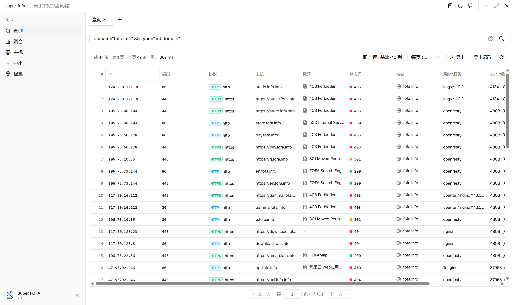
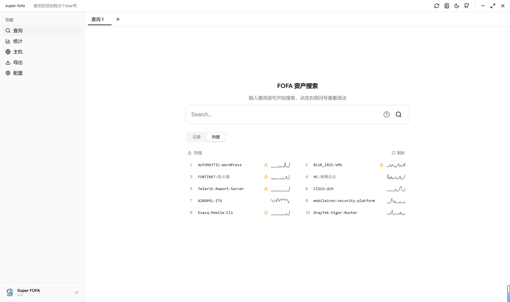
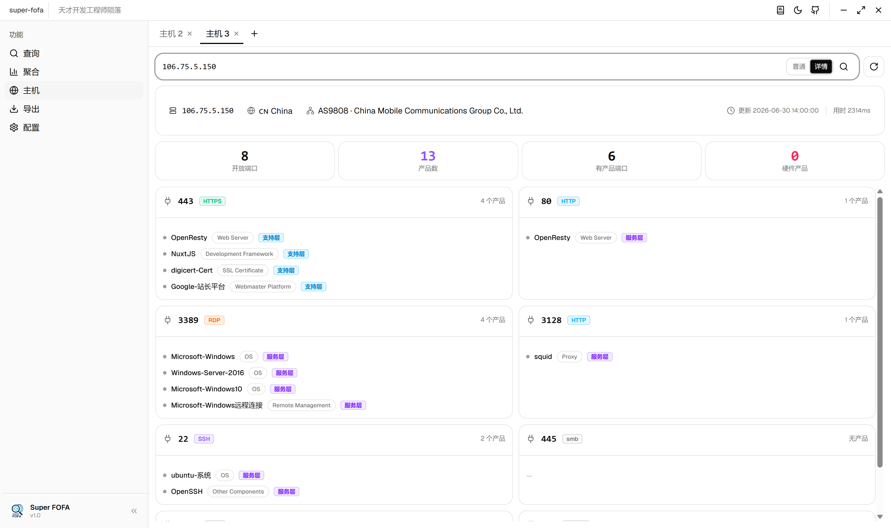
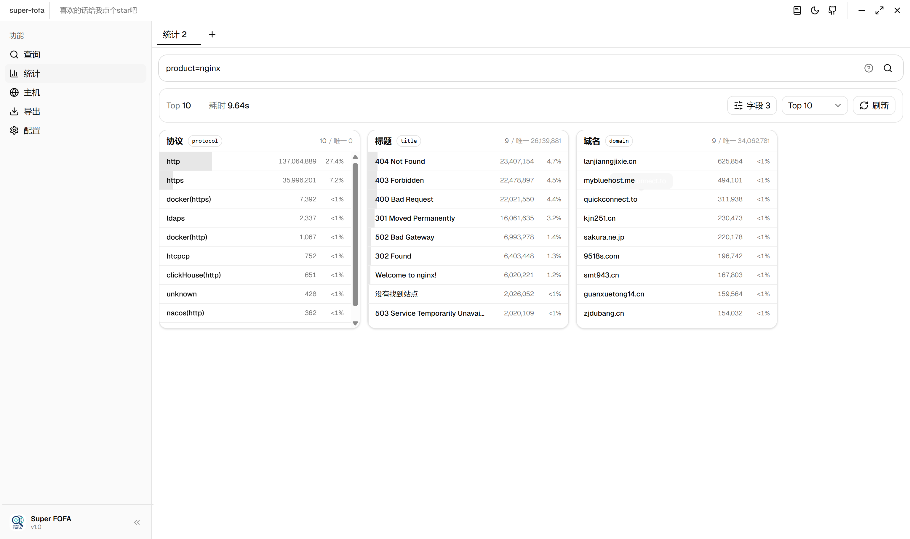
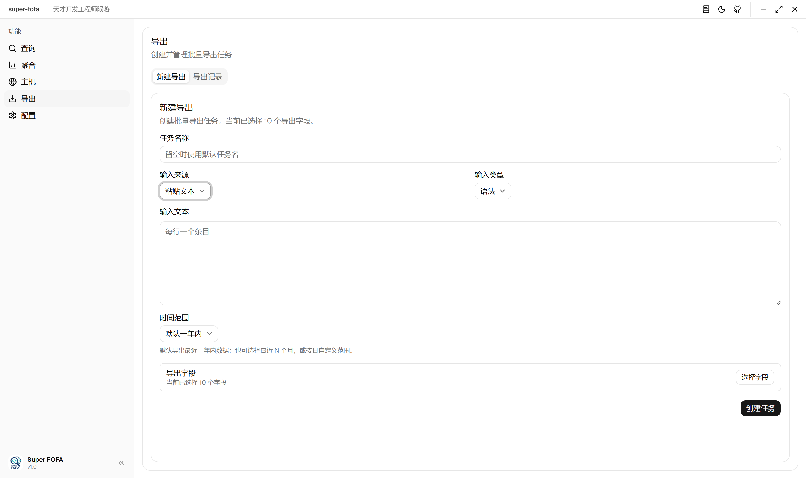
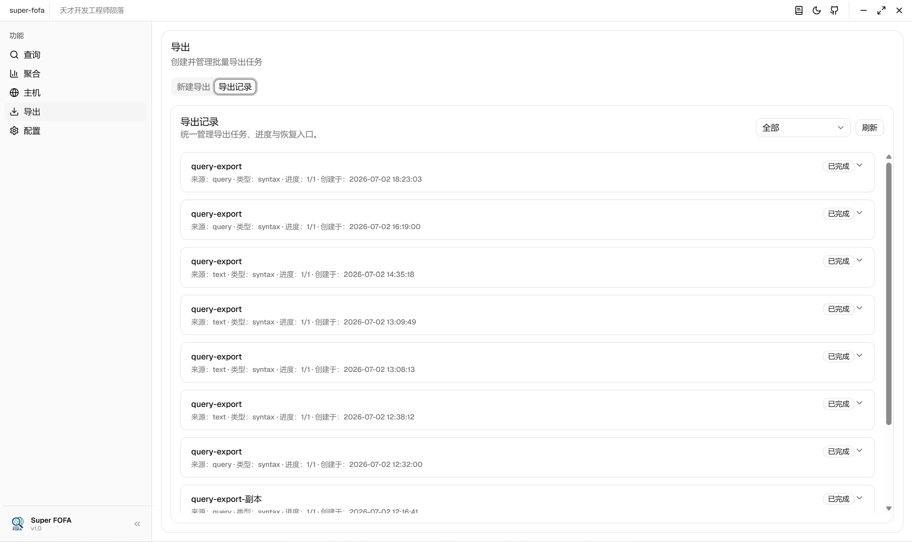
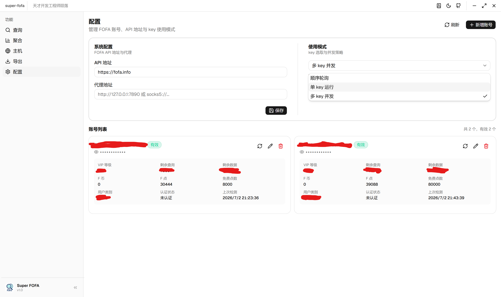

# super-fofa

A cross-platform desktop client for the [FOFA](https://fofa.info) cyberspace search engine. It brings querying, asset profiling, aggregation, batch export, and multi-key management into a fast, focused local application.

[](https://github.com/polite-007/superfofa/releases)
[](https://github.com/polite-007/superfofa/releases)
[](./LICENSE)

## Overview

super-fofa is built with Wails v2, React, TypeScript, and shadcn/ui. It wraps the FOFA APIs in a native desktop experience with local persistence and a consistent interface across macOS, Windows, and Linux.

## Features

- **Asset search** — multi-tab queries, field presets, query history, pagination, and direct links between hosts, ports, and exported data.
- **Card and list views** — a single-column asset card view for analysis, with a configurable information panel and a left-side aggregation sidebar. Switch between card and list views without re-querying.
- **Aggregation sidebar** — protocol, domain, title, country/region, and port distributions for the complete result set, including country-to-region drill-down and click-to-filter.
- **Query hot search** — browse current FOFA hot searches, inspect their details, and run them with a single click.
- **Host profile** — IPv4 host profiles in standard and detailed modes, presented as a dashboard with key indicators and port cards.
- **Aggregation statistics** — aggregate results by field, with configurable Top N, counts, percentages, and parallel field queries.
- **Batch export** — export from query syntax, IP, host, or domain inputs; select fields; pause, resume, and resume from checkpoints; write XLSX files.
- **Multi-key management** — manage multiple FOFA accounts, with sequential, single-key, and multi-key random modes, custom API base URL, proxy support, and account connectivity checks.
- **Membership-aware card fields** — choose the FOFA membership tier (Personal, Professional, Business, Enterprise); unsupported fields are locked so queries do not fail on field permissions.
- **Automatic updates** — check for updates from within the application and follow download, verification, installation, and restart progress.
- **Cross-platform** — macOS (Intel and Apple Silicon), Windows (x64 and ARM64), and Linux (x64 and ARM64).
- **Local persistence** — SQLite stores accounts, configuration, export tasks, and query history locally.
- **Light and dark themes** — a complete dark theme that follows the application's design tokens.

## Screenshots

### Asset Search


### Query Hot Searches


### Host Profile


### Aggregation Statistics


### Batch Export — Task List


### Batch Export — New Task


### Multi-key Management


## Downloads

Download the latest release from the [Releases](https://github.com/polite-007/superfofa/releases/latest) page.

| Platform | Artifact |
| --- | --- |
| macOS (Apple Silicon) | `superfofa-macos-arm64.zip` |
| macOS (Intel) | `superfofa-macos-amd64.zip` |
| Windows (x64) | `superfofa-windows-amd64.zip` |
| Windows (ARM64) | `superfofa-windows-arm64.zip` |
| Linux (x64) | `superfofa-linux-amd64.tar.gz` |
| Linux (ARM64) | `superfofa-linux-arm64.tar.gz` |
| Source snapshot | `superfofa-source-<version>.tar.gz` / `.zip` |

The full source code is available in this repository. Each release also includes a source snapshot and a `checksums.txt` file.

### Installation

- **macOS**: extract the archive and move `superfofa.app` to Applications. If Gatekeeper blocks the first launch, right-click the app and choose **Open**.
- **Windows**: extract the archive and run `superfofa.exe`. If SmartScreen blocks it, choose **More info** → **Run anyway**.
- **Linux**: extract the archive and run the `superfofa` binary.

## Quick Start

1. Open the application and go to **Configuration**.
2. Add a FOFA account with its email and API key, then run the connectivity check.
3. Open **Query**, enter a FOFA query, and run the search.
4. Switch between the list and card views, inspect the aggregation sidebar, or export the result set.

A valid FOFA API key is required for all queries.

## Build from Source

### Prerequisites

- Go 1.25 or newer
- Node.js 22 or newer
- [Wails v2 CLI](https://wails.io/docs/gettingstarted/installation)

### Build

```bash
git clone https://github.com/polite-007/superfofa.git
cd superfofa

cd frontend
npm ci
cd ..

wails build
```

The resulting application is written to `build/bin`.

### Development

```bash
wails dev
```

The frontend can also be built independently:

```bash
cd frontend
npm run build
```

## Tech Stack

- **Desktop shell**: Wails v2
- **Backend**: Go
- **Frontend**: React 18, TypeScript, shadcn/ui, Tailwind CSS v4
- **FOFA SDK**: [polite-007/toolbox](https://github.com/polite-007/toolbox)
- **Storage**: SQLite, with SQLite-backed query and host history

## Project Structure

```text
.
├── cmd/                # Auxiliary binaries, including the updater
├── internal/           # Go application, store, models, logger
│   ├── app/            # Wails-bound application services
│   ├── model/          # Shared data models
│   └── store/          # SQLite persistence
├── frontend/           # React frontend
│   └── src/
│       ├── components/ # Shared UI components
│       └── views/      # Query, host, aggregate, export, config, version
├── build/              # Wails build assets
└── .github/            # Release and source-sync workflows
```

## Contributing

Issues and pull requests are welcome. Please include a clear description, reproduction steps, and the affected platform when reporting a problem.

Before opening a pull request, make sure the frontend and backend build successfully:

```bash
cd frontend && npm run build
cd .. && go build ./...
```

## Security and Responsible Use

super-fofa is intended for authorized security research, attack-surface management, and asset inventory work. Users are responsible for obtaining the necessary authorization and for complying with FOFA's terms of service and applicable laws. The maintainers are not responsible for misuse of the software or the data it retrieves.

## License

Released under the MIT License. See [LICENSE](./LICENSE) for details.

## Acknowledgements

- [Wails](https://wails.io) — desktop application framework for Go and the web
- [shadcn/ui](https://ui.shadcn.com) — UI components
- [polite-007/toolbox](https://github.com/polite-007/toolbox) — Go SDK for FOFA
- [FOFA](https://fofa.info) — cyberspace search engine
